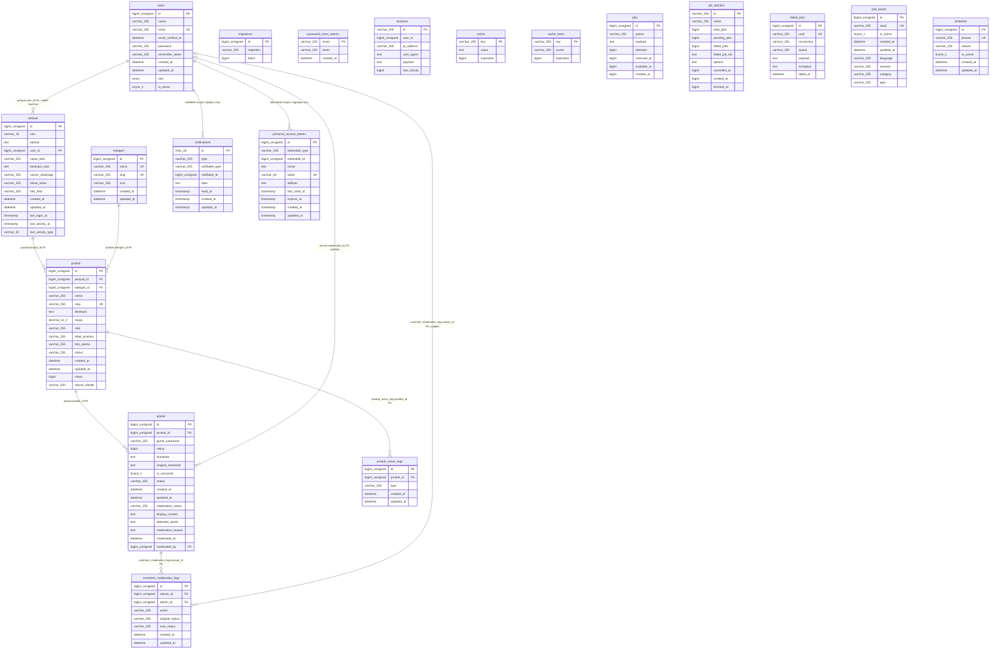

# Entity Relationship Diagram

## Database Overview

ERD ini membedakan schema MySQL yang sedang dikonfigurasi oleh project (`siswamartidmy_siswamart`) dari schema yang didefinisikan migration. Schema aktif diperiksa secara read-only dengan `php artisan db:show`, `php artisan db:table`, dan status migration pada 5 Oktober 2026.

Inventaris project mencakup seluruh 20 file migration dan 9 model di `app/Models`. Schema lain yang kebetulan tersedia pada instance MySQL tidak dimasukkan karena bukan database aktif pada konfigurasi Laravel.

Schema aktif memiliki **18 tabel**: 10 tabel aplikasi (akun, katalog, moderasi, log, dan notifikasi), 7 tabel pendukung framework (session, reset password, cache, dan queue), serta tabel metadata Laravel `migrations`. Migration project mendefinisikan satu tabel tambahan, `personal_access_tokens`, yang belum ada pada schema aktif.

Tidak ada pivot/junction table. Hubungan utama menggunakan foreign key; `notifications` dan tabel token menggunakan pola polymorphic. Field seperti `guest_username`, `bad_words`, dan `whitelists` tidak mempunyai FK ke tabel lain.

## ERD

Diagram ini menggambarkan seluruh tabel yang ditemukan di schema aktif. `personal_access_tokens` juga ditampilkan sebagai tabel **migration-only** agar hubungan yang digunakan oleh `HasApiTokens` dan API tidak tersembunyi; tabel tersebut belum ada pada database aktif. Detail kolom di diagram mengikuti schema aktif, kecuali tabel migration-only tersebut.

Tipe pada Mermaid memakai `_` untuk ukuran/parameter agar valid sebagai satu token Mermaid, misalnya `bigint_unsigned` berarti `BIGINT UNSIGNED`, `decimal_12_2` berarti `DECIMAL(12,2)`, dan `tinyint_1` berarti `TINYINT(1)`. Nullable/default dan indeks dijelaskan pada tabel berikut. `UK` berarti unique index. Field polymorphic bukan FK.

## Tables

Kolom dan constraint di bagian ini merekam schema aktif yang terhubung. `NOT NULL` berarti kolom wajib; default `—` berarti tidak ada default yang dilaporkan. Tipe dapat berbeda dari definisi migration; seluruh perbedaan yang ditemukan dicatat pada bagian Database Discrepancies.

### `migrations`

Tabel metadata yang dikelola Laravel, bukan dibuat oleh migration project.

| Column | Type | Nullable | Key / Index | Default | Description |
|---|---|---:|---|---|---|
| `id` | bigint unsigned | No | PK, auto increment | — | ID record migration |
| `migration` | varchar(255) | No | — | — | Nama file migration |
| `batch` | bigint | No | — | — | Nomor batch |

### `users`

| Column | Type | Nullable | Key / Index | Default | Description |
|---|---|---:|---|---|---|
| `id` | bigint unsigned | No | PK, auto increment | — | ID user |
| `name` | varchar(255) | No | — | — | Nama |
| `email` | varchar(255) | No | UNIQUE | — | Email |
| `email_verified_at` | datetime | Yes | — | NULL | Waktu verifikasi email |
| `password` | varchar(255) | No | — | — | Password |
| `remember_token` | varchar(255) | Yes | — | NULL | Token remember-me |
| `created_at` | datetime | Yes | — | NULL | Waktu dibuat |
| `updated_at` | datetime | Yes | — | NULL | Waktu diperbarui |
| `role` | enum(`admin`, `penjual`) | No | — | `penjual` | Peran user |
| `is_active` | tinyint(1) | No | — | `1` | Status aktif |

Model `User` memakai `Notifiable` dan `HasApiTokens`; relasi notifikasi tersedia dan API memanggil `createToken()`.

### `password_reset_tokens`

| Column | Type | Nullable | Key / Index | Default | Description |
|---|---|---:|---|---|---|
| `email` | varchar(255) | No | PK | — | Email akun |
| `token` | varchar(255) | No | — | — | Token reset |
| `created_at` | datetime | Yes | — | NULL | Waktu dibuat |

### `sessions`

| Column | Type | Nullable | Key / Index | Default | Description |
|---|---|---:|---|---|---|
| `id` | varchar(255) | No | PK | — | ID session |
| `user_id` | bigint unsigned | Yes | INDEX | NULL | ID user session; tidak memiliki FK |
| `ip_address` | varchar(255) | Yes | — | NULL | Alamat IP |
| `user_agent` | text | Yes | — | NULL | User agent |
| `payload` | text | No | — | — | Data session |
| `last_activity` | bigint | No | INDEX | — | Waktu aktivitas |

### `cache`

| Column | Type | Nullable | Key / Index | Default | Description |
|---|---|---:|---|---|---|
| `key` | varchar(255) | No | PK | — | Kunci cache |
| `value` | text | No | — | — | Nilai cache |
| `expiration` | bigint | No | INDEX | — | Waktu kedaluwarsa |

### `cache_locks`

| Column | Type | Nullable | Key / Index | Default | Description |
|---|---|---:|---|---|---|
| `key` | varchar(255) | No | PK | — | Kunci lock |
| `owner` | varchar(255) | No | — | — | Pemilik lock |
| `expiration` | bigint | No | INDEX | — | Waktu kedaluwarsa |

### `jobs`

| Column | Type | Nullable | Key / Index | Default | Description |
|---|---|---:|---|---|---|
| `id` | bigint unsigned | No | PK, auto increment | — | ID job |
| `queue` | varchar(255) | No | INDEX | — | Nama queue |
| `payload` | text | No | — | — | Payload job |
| `attempts` | bigint | No | — | — | Jumlah percobaan |
| `reserved_at` | bigint | Yes | — | NULL | Waktu reservasi |
| `available_at` | bigint | No | — | — | Waktu tersedia |
| `created_at` | bigint | No | — | — | Waktu dibuat |

### `job_batches`

| Column | Type | Nullable | Key / Index | Default | Description |
|---|---|---:|---|---|---|
| `id` | varchar(255) | No | PK | — | ID batch |
| `name` | varchar(255) | No | — | — | Nama batch |
| `total_jobs` | bigint | No | — | — | Total job |
| `pending_jobs` | bigint | No | — | — | Job tertunda |
| `failed_jobs` | bigint | No | — | — | Job gagal |
| `failed_job_ids` | text | No | — | — | Daftar ID job gagal |
| `options` | text | Yes | — | NULL | Opsi batch |
| `cancelled_at` | bigint | Yes | — | NULL | Waktu pembatalan |
| `created_at` | bigint | No | — | — | Waktu dibuat |
| `finished_at` | bigint | Yes | — | NULL | Waktu selesai |

### `failed_jobs`

| Column | Type | Nullable | Key / Index | Default | Description |
|---|---|---:|---|---|---|
| `id` | bigint unsigned | No | PK, auto increment | — | ID job gagal |
| `uuid` | varchar(255) | No | UNIQUE | — | UUID job |
| `connection` | varchar(255) | No | bagian INDEX gabungan | — | Connection queue |
| `queue` | varchar(255) | No | bagian INDEX gabungan | — | Nama queue |
| `payload` | text | No | — | — | Payload job |
| `exception` | text | No | — | — | Detail exception |
| `failed_at` | datetime | No | bagian INDEX gabungan | `CURRENT_TIMESTAMP` | Waktu gagal |

Index gabungan: (`connection`, `queue`, `failed_at`).

### `penjual`

| Column | Type | Nullable | Key / Index | Default | Description |
|---|---|---:|---|---|---|
| `id` | bigint unsigned | No | PK, auto increment | — | ID profil penjual |
| `nisn` | varchar(10) | Yes | Tidak unique pada schema aktif | NULL | NISN |
| `alamat` | text | Yes | — | NULL | Alamat |
| `user_id` | bigint unsigned | No | INDEX, FK → `users.id` | — | Pemilik akun |
| `nama_toko` | varchar(255) | No | — | — | Nama toko |
| `deskripsi_toko` | text | Yes | — | NULL | Deskripsi toko |
| `nomor_whatsapp` | varchar(255) | No | — | — | Nomor WhatsApp |
| `lokasi_kelas` | varchar(255) | Yes | — | NULL | Lokasi/kelas |
| `foto_toko` | varchar(255) | Yes | — | NULL | Path foto toko |
| `created_at` | datetime | Yes | — | NULL | Waktu dibuat |
| `updated_at` | datetime | Yes | — | NULL | Waktu diperbarui |
| `last_login_at` | timestamp | Yes | — | NULL | Login terakhir |
| `last_activity_at` | timestamp | Yes | — | NULL | Aktivitas terakhir |
| `last_activity_type` | varchar(50) | Yes | — | NULL | Jenis aktivitas terakhir |

### `kategori`

| Column | Type | Nullable | Key / Index | Default | Description |
|---|---|---:|---|---|---|
| `id` | bigint unsigned | No | PK, auto increment | — | ID kategori |
| `nama` | varchar(255) | No | UNIQUE | — | Nama kategori |
| `slug` | varchar(255) | No | UNIQUE | — | Slug kategori |
| `icon` | varchar(255) | Yes | — | NULL | Nilai/path icon |
| `created_at` | datetime | Yes | — | NULL | Waktu dibuat |
| `updated_at` | datetime | Yes | — | NULL | Waktu diperbarui |

### `produk`

| Column | Type | Nullable | Key / Index | Default | Description |
|---|---|---:|---|---|---|
| `id` | bigint unsigned | No | PK, auto increment | — | ID produk |
| `penjual_id` | bigint unsigned | No | INDEX, FK → `penjual.id` | — | Pemilik produk |
| `kategori_id` | bigint unsigned | No | INDEX, FK → `kategori.id` | — | Kategori produk |
| `nama` | varchar(255) | No | — | — | Nama produk |
| `slug` | varchar(255) | No | UNIQUE | — | Slug produk |
| `deskripsi` | text | Yes | — | NULL | Deskripsi |
| `harga` | decimal(12,2) | No | — | — | Harga |
| `stok` | varchar(255) | No | — | `ready` | Status stok; schema aktif varchar |
| `label_promosi` | varchar(255) | Yes | — | NULL | Label promosi |
| `foto_utama` | varchar(255) | Yes | — | NULL | Path foto utama |
| `status` | varchar(255) | No | — | `pending` | Status moderasi produk; schema aktif varchar |
| `created_at` | datetime | Yes | — | NULL | Waktu dibuat |
| `updated_at` | datetime | Yes | — | NULL | Waktu diperbarui |
| `views` | bigint | No | — | `0` | Counter views |
| `alasan_ditolak` | varchar(500) | Yes | — | NULL | Alasan penolakan |

### `ulasan`

| Column | Type | Nullable | Key / Index | Default | Description |
|---|---|---:|---|---|---|
| `id` | bigint unsigned | No | PK, auto increment | — | ID ulasan |
| `produk_id` | bigint unsigned | No | INDEX, FK → `produk.id` | — | Produk yang diulas |
| `guest_username` | varchar(255) | No | — | — | Nama pengunjung; bukan FK user |
| `rating` | bigint | No | — | — | Nilai rating |
| `komentar` | text | Yes | — | NULL | Komentar |
| `original_komentar` | text | Yes | — | NULL | Komentar asli |
| `is_censored` | tinyint(1) | No | — | `0` | Flag sensor |
| `status` | varchar(255) | No | — | `aktif` | Status ulasan |
| `created_at` | datetime | Yes | — | NULL | Waktu dibuat |
| `updated_at` | datetime | Yes | — | NULL | Waktu diperbarui |
| `moderation_status` | varchar(255) | No | — | `approved` | Status moderasi |
| `display_content` | text | Yes | — | NULL | Konten tampilan |
| `detected_words` | text | Yes | — | NULL | Kata terdeteksi; aktif DB bertipe text |
| `moderation_reason` | text | Yes | — | NULL | Alasan moderasi |
| `moderated_at` | datetime | Yes | — | NULL | Waktu moderasi |
| `moderated_by` | bigint unsigned | Yes | INDEX, FK → `users.id` | NULL | User moderator |

### `bad_words`

| Column | Type | Nullable | Key / Index | Default | Description |
|---|---|---:|---|---|---|
| `id` | bigint unsigned | No | PK, auto increment | — | ID kata |
| `word` | varchar(255) | No | UNIQUE | — | Kata yang difilter |
| `is_active` | tinyint(1) | No | — | `1` | Status aktif |
| `created_at` | datetime | Yes | — | NULL | Waktu dibuat |
| `updated_at` | datetime | Yes | — | NULL | Waktu diperbarui |
| `language` | varchar(255) | No | — | `indonesian` | Bahasa |
| `severity` | varchar(255) | No | — | `medium` | Tingkat |
| `category` | varchar(255) | Yes | — | NULL | Kategori |
| `type` | varchar(255) | No | — | `custom` | Jenis kata |

### `produk_views_logs`

| Column | Type | Nullable | Key / Index | Default | Description |
|---|---|---:|---|---|---|
| `id` | bigint unsigned | No | PK, auto increment | — | ID log |
| `produk_id` | bigint unsigned | No | FK → `produk.id`; INDEX gabungan | — | Produk terkait |
| `type` | varchar(255) | No | INDEX gabungan | `view` | Tipe interaksi, mis. view/WhatsApp |
| `created_at` | datetime | Yes | INDEX gabungan | NULL | Waktu dibuat |
| `updated_at` | datetime | Yes | — | NULL | Waktu diperbarui |

Index gabungan: (`produk_id`, `created_at`) dan (`type`, `created_at`).

### `whitelists`

| Column | Type | Nullable | Key / Index | Default | Description |
|---|---|---:|---|---|---|
| `id` | bigint unsigned | No | PK, auto increment | — | ID phrase |
| `phrase` | varchar(255) | No | UNIQUE | — | Phrase yang dikecualikan dari filter |
| `reason` | varchar(255) | Yes | — | NULL | Alasan |
| `is_active` | tinyint(1) | No | — | `1` | Status aktif |
| `created_at` | datetime | Yes | — | NULL | Waktu dibuat |
| `updated_at` | datetime | Yes | — | NULL | Waktu diperbarui |

### `comment_moderation_logs`

| Column | Type | Nullable | Key / Index | Default | Description |
|---|---|---:|---|---|---|
| `id` | bigint unsigned | No | PK, auto increment | — | ID log |
| `ulasan_id` | bigint unsigned | No | INDEX, FK → `ulasan.id` | — | Ulasan terkait |
| `admin_id` | bigint unsigned | Yes | INDEX, FK → `users.id` | NULL | User pelaku; role admin tidak dipaksa oleh FK |
| `action` | varchar(255) | No | — | — | Aksi moderasi |
| `original_status` | varchar(255) | Yes | — | NULL | Status sebelumnya |
| `new_status` | varchar(255) | No | — | — | Status baru |
| `created_at` | datetime | Yes | — | NULL | Waktu dibuat |
| `updated_at` | datetime | Yes | — | NULL | Waktu diperbarui |

### `notifications`

| Column | Type | Nullable | Key / Index | Default | Description |
|---|---|---:|---|---|---|
| `id` | char(36) | No | PK | — | UUID notifikasi |
| `type` | varchar(255) | No | — | — | Class/type notifikasi |
| `notifiable_type` | varchar(255) | No | bagian INDEX morph | — | Morph class penerima |
| `notifiable_id` | bigint unsigned | No | bagian INDEX morph | — | ID penerima |
| `data` | text | No | — | — | Payload notifikasi |
| `read_at` | timestamp | Yes | — | NULL | Waktu dibaca |
| `created_at` | timestamp | Yes | — | NULL | Waktu dibuat |
| `updated_at` | timestamp | Yes | — | NULL | Waktu diperbarui |

Index gabungan: (`notifiable_type`, `notifiable_id`). Tidak ada FK database karena target polymorphic.

### `personal_access_tokens` — migration-only

Tabel ini didefinisikan migration dan digunakan oleh Sanctum melalui `User::HasApiTokens`, tetapi **tidak ditemukan** pada schema aktif.

| Column | Type menurut migration | Nullable | Key / Index | Default | Description |
|---|---|---:|---|---|---|
| `id` | bigint unsigned | No | PK, auto increment | — | ID token |
| `tokenable_type` | varchar(255) | No | bagian INDEX morph | — | Morph class pemilik token |
| `tokenable_id` | bigint unsigned | No | bagian INDEX morph | — | ID pemilik token |
| `name` | text | No | — | — | Nama token |
| `token` | varchar(64) | No | UNIQUE | — | Hash token |
| `abilities` | text | Yes | — | NULL | Kemampuan token |
| `last_used_at` | timestamp | Yes | — | NULL | Penggunaan terakhir |
| `expires_at` | timestamp | Yes | INDEX | NULL | Kedaluwarsa |
| `created_at` | timestamp | Yes | — | NULL | Waktu dibuat |
| `updated_at` | timestamp | Yes | — | NULL | Waktu diperbarui |

Index morph gabungan: (`tokenable_type`, `tokenable_id`). Tidak ada FK database untuk target polymorphic.

## Relationships

Cardinality berikut adalah berdasarkan FK fisik/schema, bukan semata nama method. `1:N` berarti satu record parent dapat memiliki banyak child; `N:1` adalah arah balik.

| From | Relationship | To | Foreign Key | Description |
|---|---|---|---|---|
| `users` | `hasOne` (`User::penjual`) / `belongsTo` (`Penjual::user`); schema `1:N` | `penjual` | `penjual.user_id → users.id` | Pasangan method Eloquent; FK tidak unique sehingga database mengizinkan beberapa profil untuk satu user. Delete user cascade. |
| `penjual` | `hasMany` (`Penjual::produk`) / `belongsTo` (`Produk::penjual`); `1:N` | `produk` | `produk.penjual_id → penjual.id` | Penjual memiliki produk; delete penjual cascade. |
| `kategori` | `hasMany` (`Kategori::produk`) / `belongsTo` (`Produk::kategori`); `1:N` | `produk` | `produk.kategori_id → kategori.id` | Kategori memiliki produk; delete kategori dibatasi (`RESTRICT`/`NO ACTION`). |
| `produk` | `hasMany` (`Produk::ulasan`) / `belongsTo` (`Ulasan::produk`); `1:N` | `ulasan` | `ulasan.produk_id → produk.id` | Produk memiliki ulasan; delete produk cascade. |
| `users` | `hasMany` secara FK / `belongsTo` (`Ulasan::moderator`); `1:N` | `ulasan` | `ulasan.moderated_by → users.id` (nullable) | User dapat memoderasi ulasan; delete user mengosongkan moderator (`SET NULL`). |
| `produk` | `hasMany` (`Produk::viewsLogs`) / `belongsTo` (`ProdukViewLog::produk`); `1:N` | `produk_views_logs` | `produk_views_logs.produk_id → produk.id` | Log interaksi produk; delete produk cascade. |
| `ulasan` | `hasMany` (`Ulasan::moderationLogs`) / `belongsTo` (`CommentModerationLog::ulasan`); `1:N` | `comment_moderation_logs` | `comment_moderation_logs.ulasan_id → ulasan.id` | Log moderasi; delete ulasan cascade. |
| `users` | `hasMany` secara FK / `belongsTo` (`CommentModerationLog::admin`); `1:N` | `comment_moderation_logs` | `comment_moderation_logs.admin_id → users.id` (nullable) | Log mencatat user; delete user mengosongkan admin_id (`SET NULL`). FK tidak memastikan role `admin`. |
| `users` | morph many, `1:N` untuk User yang digunakan aplikasi | `notifications` | `notifiable_type` + `notifiable_id` | `Notifiable` dan `notifications()` dipakai service/controller; pasangan morph berindeks, bukan FK. |
| `users` | morph many menurut migration; migration-only | `personal_access_tokens` | `tokenable_type` + `tokenable_id` | Sanctum `HasApiTokens`; tabel belum ada di schema aktif, sehingga relasi persistennya belum siap di database tersebut. |

Tidak ada model/relation pivot `belongsToMany`. `sessions.user_id` adalah relasi implisit penyimpanan session Laravel yang nullable dan berindeks, tetapi bukan FK dan tidak didefinisikan sebagai relasi Eloquent pada model project; karena itu tidak dihitung sebagai relationship FK.

## Database Discrepancies

### Migration status dan tabel

- Status migration pada koneksi aktif menunjukkan **16 Ran dan 4 Pending**: `2026_09_25_000001_create_notifications_table`, `2026_09_25_064535_create_personal_access_tokens_table`, `2026_09_28_000001_add_rejection_reason_to_produk_table`, dan `2026_09_28_000002_add_seller_profile_activity_fields`.
- `notifications`, `produk.alasan_ditolak`, serta field profil penjual dari migration yang berstatus Pending sudah ada secara fisik. Sebaliknya, `personal_access_tokens` tidak ada di koneksi aktif walaupun migration tersedia dan API memanggil Sanctum `createToken()`.
- Keadaan ini menunjukkan schema dan tabel `migrations` tidak sepenuhnya sinkron. Migration `create_notifications_table` dapat bertabrakan dengan tabel yang telah ada; migration penambahan kolom juga berpotensi bertabrakan dengan kolom yang sudah ada. Perlu verifikasi sebelum menjalankan migration; ERD ini tidak mengubah database.

### Perbedaan tipe/ukuran/constraint migration terhadap schema aktif

| Table.column | Migration | Schema aktif | Catatan |
|---|---|---|---|
| `users.remember_token` | varchar(100) dari `rememberToken()` | varchar(255) | Lebar berbeda. |
| `password_reset_tokens.created_at` | timestamp nullable | datetime nullable | Tipe berbeda. |
| `sessions.ip_address` | varchar(45) | varchar(255) | Lebar berbeda. |
| `sessions.payload` | longText | text | Kapasitas tipe berbeda. |
| `sessions.last_activity` | integer | bigint | Tipe berbeda. |
| `sessions.user_id` | nullable, indexed, bukan FK | Sama | Berpotensi menyimpan user_id orphan. |
| `created_at`/`updated_at` pada `users`, `penjual`, `kategori`, `produk`, `ulasan`, `bad_words`, `produk_views_logs`, `whitelists`, `comment_moderation_logs` | timestamp nullable dari `$table->timestamps()` | datetime nullable | Tipe aktual berbeda; `notifications` memakai timestamp dan sesuai migration. |
| `cache.value` | mediumText | text | Tipe berbeda. |
| `jobs.payload` | longText | text | Tipe berbeda. |
| `jobs.attempts` | unsignedSmallInteger | bigint | Tipe berbeda. |
| `jobs.reserved_at`, `available_at`, `created_at` | unsignedInteger | bigint | Tipe berbeda; `reserved_at` tetap nullable. |
| `job_batches.total_jobs`, `pending_jobs`, `failed_jobs`, `cancelled_at`, `created_at`, `finished_at` | integer | bigint | Tipe berbeda; nullability mengikuti migration. |
| `job_batches.failed_job_ids` | longText | text | Tipe berbeda. |
| `job_batches.options` | mediumText | text | Tipe berbeda. |
| `failed_jobs.payload`, `exception` | longText | text | Tipe berbeda. |
| `failed_jobs.failed_at` | timestamp dengan current time | datetime dengan current time | Tipe berbeda; default current time tetap ada. |
| `penjual.nisn` | varchar(20), UNIQUE | varchar(10), tidak ada unique index | Ukuran dan constraint berbeda. |
| `penjual.nomor_whatsapp` | varchar(20) | varchar(255) | Lebar berbeda. |
| `penjual.lokasi_kelas` | varchar(100) | varchar(255) | Lebar berbeda. |
| `penjual.last_activity_type` | varchar(80) | varchar(50) | Lebar berbeda. |
| `kategori.nama`, `kategori.slug` | varchar(100) | varchar(255) | Unique index tetap ada; ukuran berbeda. |
| `produk.stok`, `produk.status` | enum (masing-masing tiga nilai stok dan status moderasi) | varchar(255) | Database aktif tidak membatasi nilai melalui enum. |
| `produk.views` | unsignedInteger | bigint | Tipe berbeda. |
| `produk.alasan_ditolak` | text pada migration Pending | varchar(500) | Tipe berbeda. |
| `ulasan.rating` | unsignedTinyInteger | bigint | Tipe berbeda. |
| `ulasan.status`, `ulasan.moderation_status` | varchar(30) | varchar(255) | Lebar berbeda. |
| `ulasan.detected_words` | JSON | text | Tipe berbeda; model tetap melakukan cast sebagai array. |
| `bad_words.language`, `severity`, `category`, `type` | varchar(30), varchar(20), varchar(50), varchar(20) | varchar(255) | Lebar berbeda. |
| `produk_views_logs.type` | varchar(20) | varchar(255) | Lebar berbeda. |
| `comment_moderation_logs.action` | varchar(50) | varchar(255) | Lebar berbeda. |
| `comment_moderation_logs.original_status`, `new_status` | varchar(30) | varchar(255) | Lebar berbeda. |

FK fisik yang ditemukan pada schema aktif sesuai pasangan yang didefinisikan migration: `penjual.user_id`, `produk.penjual_id`, `produk.kategori_id`, `ulasan.produk_id`, `ulasan.moderated_by`, `produk_views_logs.produk_id`, `comment_moderation_logs.ulasan_id`, dan `comment_moderation_logs.admin_id`. Tidak ditemukan FK untuk `sessions.user_id` atau pasangan polymorphic.

### Model dan kode aplikasi

- `User::penjual()` adalah `hasOne`, tetapi `penjual.user_id` tidak unique pada migration maupun database aktif. Karena itu cardinality database yang dijamin adalah `1:N`, bukan `1:1`.
- Model-model domain yang memiliki relasi eksplisit: `User`, `Penjual`, `Produk`, `Kategori`, `Ulasan`, `ProdukViewLog`, dan `CommentModerationLog`. `BadWord` dan `Whitelist` berdiri sendiri.
- `notifications` dimanfaatkan melalui trait `Notifiable`; tidak ada model notifikasi buatan project. `personal_access_tokens` dimanfaatkan melalui trait Sanctum `HasApiTokens`, tetapi belum ada pada schema aktif.
- Seeder mendukung interpretasi hubungan `users`–`penjual` dan `penjual`/`kategori`–`produk`; tidak menambahkan constraint atau relationship lain.

## ERD Validation

- **Total tabel pada schema aktif:** 18 (17 tabel aplikasi/framework + `migrations`).
- **Inventaris source:** 20 file migration, 18 deklarasi `Schema::create`, dan 9 model Eloquent.
- **Tabel migration-only:** 1 (`personal_access_tokens`); migration-nya Pending dan tabel tidak ditemukan pada koneksi aktif.
- **Total relationship aktif pada diagram:** 9 asosiasi (8 FK + 1 polymorphic `notifications` yang dipakai User).
- **Relationship tambahan yang didefinisikan migration tetapi belum aktif:** 1 polymorphic token (`personal_access_tokens`).
- **Total foreign key aktif:** 8.
- **Pivot/junction tables:** 0.
- **Index penting:** PK seluruh tabel; unique `users.email`, `kategori.nama`, `kategori.slug`, `produk.slug`, `bad_words.word`, `whitelists.phrase`, `failed_jobs.uuid`; index FK dan index gabungan pada log, session, notifikasi, cache, queue sesuai tabel.
- **Potential issues:** `User::penjual()` one-to-one tidak dijamin unique; NISN tidak unique pada DB aktif meski migration menyatakannya; `sessions.user_id` tidak memiliki FK; migration status dan schema berbeda; tabel token Sanctum belum tersedia.
- **Orphan/foreign-key consistency:** seluruh 8 FK aktif menunjuk tabel/kolom tujuan yang tersedia dan memakai constraint InnoDB. `sessions.user_id` dan pasangan morph tidak dapat dijamin bebas orphan oleh FK. Pemeriksaan ini memvalidasi metadata FK, bukan audit setiap nilai orphan dalam data.
- **Pivot review:** tidak ditemukan tabel pivot atau relasi `belongsToMany`.
- **Konsistensi akhir:** diagram dan katalog membedakan schema aktif, migration, dan relasi model. ERD konsisten dengan FK aktif; schema aktif **tidak sepenuhnya konsisten** dengan migration/model sebagaimana discrepancy di atas.
